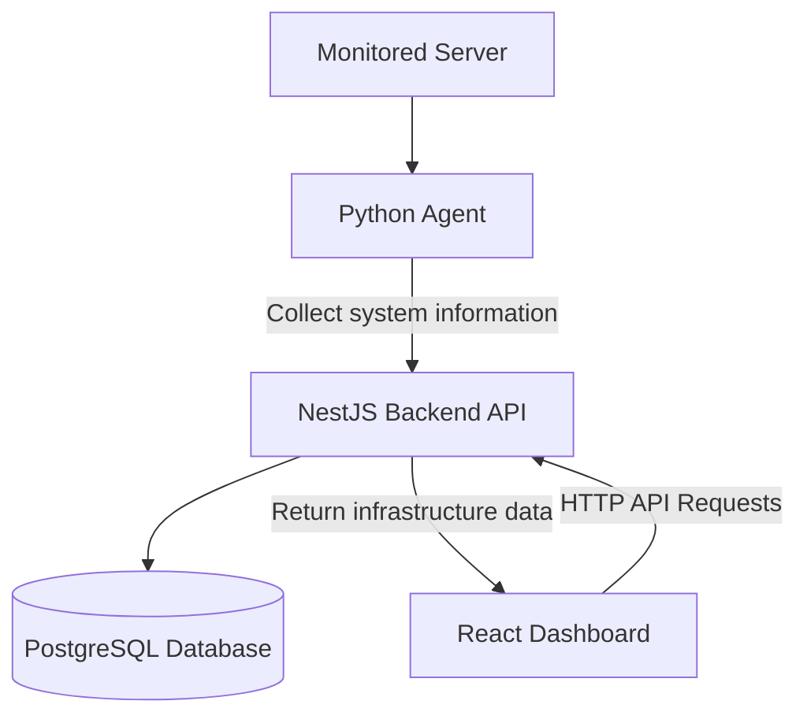

# InfraVision

### Infrastructure Explorer

**Explore your infrastructure in one place.**

InfraVision is a web-based infrastructure monitoring and exploration platform that brings essential server information into a centralized dashboard. It helps developers and system administrators explore server resources, running processes, Docker containers, network interfaces, storage information, and system logs without switching between multiple tools.

The project focuses on making infrastructure information easier to collect, access, and understand through a single interface.

---

## Overview

Managing server information often requires using multiple tools, commands, and monitoring interfaces.

InfraVision aims to simplify this experience by collecting infrastructure data through a lightweight Python Agent, processing and storing the data through a backend API, and presenting it in a centralized web dashboard.

The platform is designed to provide visibility into server environments while keeping its primary purpose focused on **exploration and monitoring rather than infrastructure control**.

## Key Features

### Dashboard
- View an overview of registered servers.
- Monitor CPU, memory, and disk usage.
- Access key infrastructure information from one place.

### Server Explorer
- Explore registered server information.
- View server details and resource metrics.
- Monitor server status and collected information.

### Docker Explorer
- Explore Docker containers on monitored servers.
- View container names, IDs, images, and statuses.
- Inspect container information from the dashboard.

### Process Explorer
- View running processes on monitored servers.
- Explore process information such as PID, name, username, CPU usage, and memory usage.

### Network Explorer
- Explore network interfaces.
- View collected network information and interface details.

### Storage Explorer
- Explore disk and storage information.
- Monitor disk usage and available storage metrics.

### Logs Explorer
- Retrieve and explore collected system logs.
- View log information through a centralized interface.

---

## System Architecture

InfraVision uses a client-server architecture with a Python Agent responsible for collecting information from monitored machines.



### Data Collection Flow

1. **Agent Collection** — The Python Agent collects system information and infrastructure metrics from the monitored machine.
2. **Data Transmission** — The Agent sends collected information to the backend through API requests.
3. **Data Processing** — The NestJS backend receives and processes the incoming data.
4. **Data Storage** — Infrastructure information is stored in PostgreSQL using Prisma.
5. **Data Visualization** — The React dashboard retrieves the stored information through the backend API and displays it in the corresponding Explorer pages.

---

## Tech Stack

| Component | Technologies |
|---|---|
| Frontend | React, TypeScript, Tailwind CSS |
| Backend | NestJS, TypeScript |
| ORM | Prisma |
| Database | PostgreSQL |
| Agent | Python |
| System Monitoring | psutil |
| Container Information | Docker SDK |
| Containerization | Docker |
| Version Control | Git, GitHub |

---

## Project Structure

```text
InfraVision/
├── agent/
│   ├── collector.py
│   ├── cpu_reader.py
│   ├── memory_reader.py
│   ├── disk_reader.py
│   ├── process_reader.py
│   ├── network_reader.py
│   ├── docker_reader.py
│   ├── logs_reader.py
│   └── sender.py
│
├── backend/
│   ├── prisma/
│   └── src/
│
├── frontend/
│   └── src/
│
└── docs/
```

*The structure above highlights the main application components. Individual files and modules may evolve during development.*

---

## Current Development Status

**Project Progress: Approximately 90%**

The core functionality of InfraVision has been implemented, and the main data collection, backend API, database integration, and dashboard data retrieval workflows are working.

| Component | Status |
|---|---|
| Python Agent | Implemented |
| System Metrics Collection | Working |
| Backend API | Working |
| PostgreSQL Integration | Working |
| Dashboard Data Integration | Working |
| Docker Explorer | Working |
| Process Explorer | Working |
| Network Explorer | Working |
| Storage Explorer | Working |
| Logs Explorer | Working |
| Frontend Refinement | In Progress |

The remaining work mainly focuses on frontend refinement and improving the overall user experience.

---

## Getting Started

### Prerequisites

Make sure the following tools are installed:

- Node.js and npm
- Python
- PostgreSQL
- Docker
- Git

### Clone the Repository

```bash
git clone https://github.com/Sanghuen/InfraVision.git
cd InfraVision
```

### Backend Setup

```bash
cd backend
npm install
```

Configure the database connection and required environment variables in the backend environment configuration.

Generate Prisma Client and apply database migrations:

```bash
npx prisma generate
npx prisma migrate dev
```

Start the development server using the available npm script.

### Frontend Setup

```bash
cd frontend
npm install
```

Configure the backend API URL and start the frontend using the available npm development script.

### Agent Setup

```bash
cd agent
```

Install the Python dependencies specified by the project and configure the Agent to connect to the backend API.

Run the Agent on the machine you want to monitor.

*Note: Environment variables and configuration values must be set according to your local environment.*

---

## Project Goals

InfraVision was developed to explore practical concepts in:

- Infrastructure monitoring and system information collection
- Backend API development
- Database design and data management
- Python-based system monitoring
- Docker container information retrieval
- Frontend and backend integration
- Distributed data collection across server environments

## Future Improvements

- Refine dashboard layout and user experience.
- Improve data visualization and information presentation.
- Enhance monitoring and data collection capabilities.
- Improve overall application stability and usability.

---

## Author

**Sanghuen**

Computer Science Student  
Maejo University

GitHub: [@Sanghuen](https://github.com/Sanghuen)

---

*InfraVision — Explore your infrastructure in one place.*
